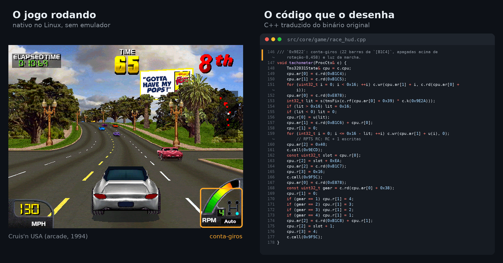
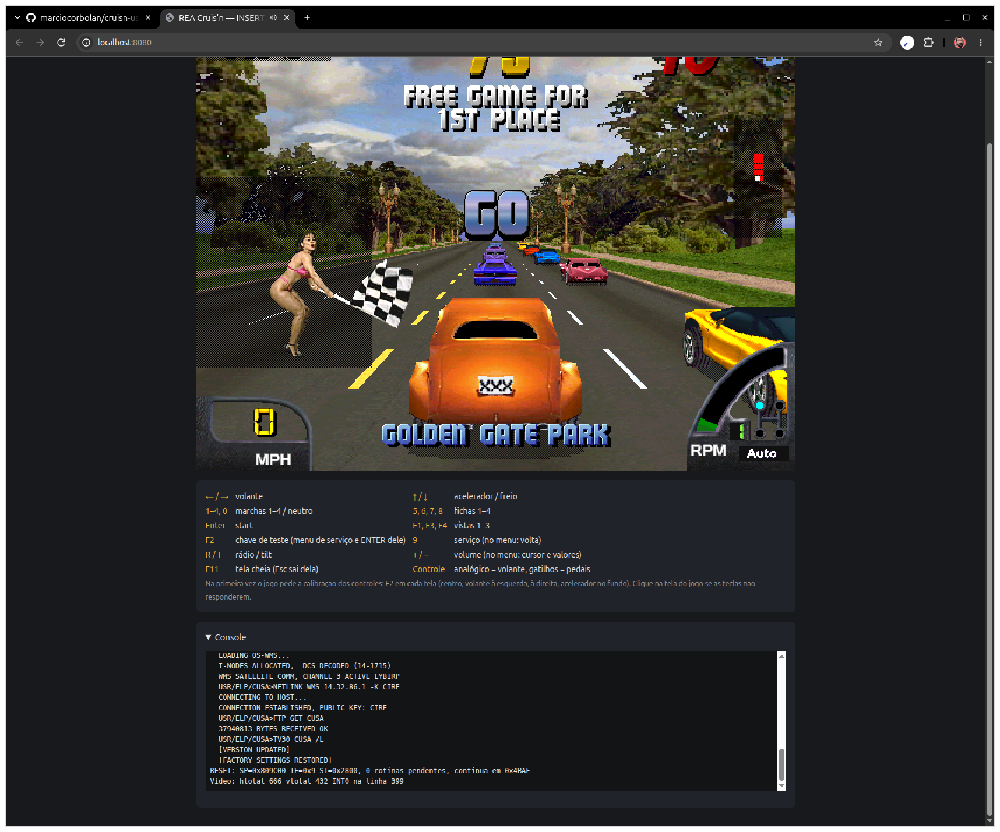
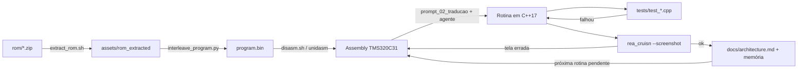
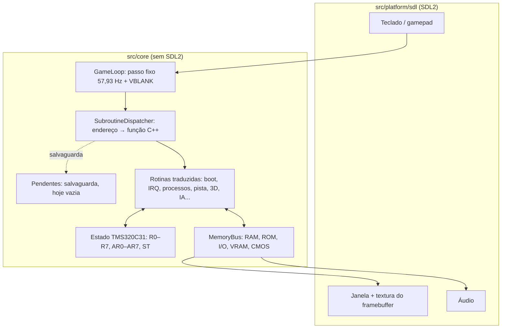
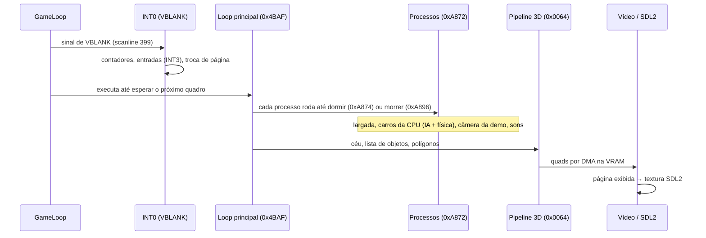

# Cruis'n USA — port em C++ por Engenharia Reversa (REA)

Estudo de **Engenharia Reversa**: um agente de IA traduziu o código de máquina do arcade
*Cruis'n USA* (Midway, 1994 — V-Unit, CPU TMS320C31) para **C++17 modular e testado**, executado nativamente com
**SDL2**.



*À esquerda, o jogo rodando nativo no Linux, sem emulador; à direita, a função C++ que desenha o conta-giros
destacado, traduzida da rotina `0x9E22` da ROM (`src/core/game/race_hud.cpp`).*

### Tradução estática vs. emulação

Diferente de emuladores tradicionais (como o MAME), que interpretam as instruções da ROM em tempo real, este
projeto faz **recompilação estática**: cada rotina da CPU foi convertida pela IA numa função C++ nativa,
registrada no endereço original. O hardware em volta (vídeo, DMA, som) é simulado, mas o processador roda código
C++ compilado. O registro de rotinas pendentes está totalmente zerado.

> **Atenção à ROM (versão L4.1):** o projeto **não distribui arquivos da ROM**. O código traduzido usa o arquivo
> original (set MAME `crusnusa`, chips `cusa-l41.u10`–`u13`) **só para ler dados** (gráficos, áudio e tabelas).
> A exigência da versão L4.1 é a prova técnica de que o projeto é uma tradução literal, e não um emulador
> genérico: qualquer outra versão desalinha os dados e falha no autoteste
> ([detalhes](#32-rom-versão-suportada-e-conferência)).

**Para jogar não é preciso repetir o estudo:** o código traduzido já está neste repositório. Basta a sua ROM e
compilar ([seção 3](#3-como-executar-e-testar)). A [seção 4](#4-como-reproduzir-o-estudo) mostra como o
estudo foi feito, para quem quiser examinar ou repetir a abordagem.

---

## Sumário

1. [Avisos legais](#1-avisos-legais)
2. [Estado atual](#2-estado-atual)
3. [Como executar e testar](#3-como-executar-e-testar)
   - [3.1 Requisitos](#31-requisitos) · [3.2 ROM: versão suportada e conferência](#32-rom-versão-suportada-e-conferência) ·
     [3.3 Escolha a forma de rodar](#33-escolha-a-forma-de-rodar)
   - [3.4 Linux: pacote pronto](#34-linux-pacote-pronto-recomendado-para-jogar) ·
     [3.5 Linux: ambiente de desenvolvimento](#35-linux-ambiente-de-desenvolvimento) ·
     [3.6 Windows](#36-windows-compilação-cruzada) · [3.7 Web](#37-web-navegador)
   - [3.8 Primeiro boot e calibração](#38-primeiro-boot-e-calibração) · [3.9 Controles](#39-controles) ·
     [3.10 Ajustes do operador](#310-ajustes-do-operador-menu-de-serviço) ·
     [3.11 Opções do executável](#311-opções-do-executável) · [3.12 Testes](#312-testes)
4. [Como reproduzir o estudo](#4-como-reproduzir-o-estudo)
   - [4.1 Requisitos do estudo](#41-requisitos-do-estudo) · [4.2 Passo a passo](#42-passo-a-passo) ·
     [4.3 O que os prompts fizeram](#43-o-que-os-prompts-fizeram) ·
     [4.4 Fluxo de trabalho da REA](#44-fluxo-de-trabalho-da-rea) · [4.5 Tokens e tempo](#45-tokens-e-tempo) ·
     [4.6 Cronologia do desenvolvimento](#46-cronologia-do-desenvolvimento)
5. [Extra](#5-extra)
   - [5.1 Estrutura de arquivos](#51-estrutura-de-arquivos) · [5.2 Arquitetura em execução](#52-arquitetura-em-execução) ·
     [5.3 Re-skin de texturas](#53-re-skin-de-texturas) · [5.4 Sons externos](#54-sons-externos) ·
     [5.5 Documentação do código (Doxygen)](#55-documentação-do-código-doxygen)

---

## 1. Avisos legais

> **Leia antes de usar.** Este repositório existe só para estudo e pesquisa.

- *Cruis'n USA*, seus nomes, marcas, gráficos, sons e código são propriedade dos respectivos detentores
  (Midway Games / Nintendo e sucessores). Este projeto **não tem afiliação** com eles nem é endossado por eles.
- **Nenhuma ROM é distribuída aqui.** A pasta `rom/` e os arquivos extraídos (`assets/rom_extracted/`) estão
  no `.gitignore`. Você precisa ter a sua própria cópia legal da placa/ROM.

**Não é permitido:**

- distribuir ROMs, trechos da ROM, dados extraídos dela (texturas, sons, modelos, tabelas) ou binários que
  os contenham;
- usar o projeto ou o código gerado para fins comerciais (venda, monetização, máquinas operadas por ficha);
- publicar builds jogáveis que dispensem a ROM do usuário ou que a embutam;
- remover os créditos e os avisos de propriedade, ou apresentar o jogo como obra própria;
- usar o material para contornar proteções de software de terceiros.

**Licença:** o código deste repositório está sob a **GNU GPL v3** (veja [`LICENSE`](LICENSE)). A licença
vale só para o código escrito aqui. Ela não cobre o jogo original, suas marcas nem os dados da ROM. Os pacotes
(Linux, Windows e Web) levam o `LICENSE`, o `LICENCAS-TERCEIROS.txt` (as bibliotecas que vão junto: runtime do GCC,
SDL2, MinGW-w64, Emscripten, musl e libc++, conforme a plataforma) e os textos dessas licenças em `licencas/`.

O código C++ escrito aqui é uma tradução de estudo. Tabelas e constantes lidas da ROM em tempo de execução
continuam sendo dados do jogo original. Na dúvida, consulte as leis de direito autoral do seu país antes
de qualquer uso fora do estudo pessoal.

---

## 2. Estado atual

| Área | Situação |
|---|---|
| Boot, RESET, interrupções (VBLANK/INT0, entradas/INT3) | traduzido |
| Autoteste de energização (`0x62D5`/`0x6381`): RAMs, checksums das 20 EPROMs, RAM de texturas, CMOS e a tela "CPU BOARD TEST" | traduzido |
| Calibração dos controles (`0x0CC0`, CALIBRATE CONTROLS): no primeiro boot (CMOS vazia), após a restauração de fábrica e pelo menu de serviço | traduzido; a CMOS é guardada em `save/cmos.nv` |
| Menu de serviço do operador (F2, `0x05F6`–`0x154C`): diagnósticos (chaves, DIPs, CPU, som, volante, monitor, burn-in, lâmpadas), auditorias, ajustes, preços padrão e personalizados, utilitários, volume e saída para o jogo | traduzido, com o registro de erros da CMOS (`0xAB79`) e a calibração (`0x0CC0`) |
| Plataforma de movimento de 3 eixos (gabinete com movimento: instalação, menu de movimento, inclinação durante a corrida) | traduzido |
| Escalonador de processos cooperativos, CMOS/NVRAM | traduzido |
| Vídeo: páginas, texto, paletas, céu, pipeline 3D, DMA de polígonos | traduzido |
| Descompressor LZW de texturas, carga da pista, fluxo de trechos | traduzido |
| Modo de atração: tela de título, recordes, demo na pista | traduzido |
| Carros da CPU: criação, física vertical, dinâmica de direção, IA, largada, rodas animadas, posição, carros de tráfego, colisão entre carros | traduzido |
| Colisão com objetos da pista (sólidos, arremessados, tombados) | traduzido |
| Driver de comandos de som (lado da CPU) | traduzido |
| Áudio DCS (ADSP-2105: samples e música) | traduzido: autoteste com bipe, residente (comandos, roteiros, 4 canais, transformada de 128 pontos) e overlays de decodificação; `AudioManager` entrega o PCM à saída SDL a 31 250 Hz |
| Fumaça de batida, raspão e arrancada | traduzido |
| Objetos animados do cenário (tabela de tratadores `[4500]` completa: incluindo 0x767/0x768, o grupo 0x260/0x261 dos tipos 0x470–0x476 que pode ser derrubado e os objetos 0x498 que deslizam) | traduzido |
| Pista 2: carro especial 0x270 (`0x7C86`–`0x7EE8`); encerramento após a última etapa (`0x8481`) e painéis da tela (`0xB07B`–`0xB07F`) | traduzido |
| Pistas 9 e 11: eventos de beira de estrada (`0x69A8`–`0x6C8B`); créditos finais (`0xA179`–`0xA2AA`; também pelo atalho VIEW2+VIEW3 no reinício, caso −6 `0xA1EA`) | traduzido |
| Detritos dos objetos 0x615, nuvens e partículas de objetos | traduzido |
| Batida forte em outro carro (carro arremessado que quica e capota, capotagem do jogador) | traduzido |
| Fichas, créditos e botão START (entrada no modo de jogo) | traduzido |
| Link entre dois gabinetes: protocolo da placa, pacotes, os 33 tipos de mensagem (incluindo o estado dos carros, a passagem de carros de tráfego e as batidas), o carro do outro jogador (`0xA66E`/`0xA6F8`) e a espera na entrada da corrida (`0x161F`) | traduzido; validado por co-simulação nos testes e com dois executáveis ligados (`--link master`/`--link slave`): os dois correm juntos e cada um vê o carro do outro |
| Fluxo da partida (processo `0x1775`, chamadas locais na pilha do PCB) e tela "HEAD 2 HEAD / JOIN IN NOW" do link (`0x154D`, caso −7; vista no Slave com dois executáveis) | traduzido |
| Seleção de percurso (mapa dos EUA, volante/botões de vista/acelerador) | traduzido |
| Seleção de câmbio e de carro (garagem com 4 carros, fichas técnicas) | traduzido |
| Entrada na corrida (garagem → pista, largada, carros da CPU, saída do carro do jogador) | traduzido |
| Corrida com o jogador: processo do carro `0x29B8` (pedais, câmbio, volante, câmeras 0/1/2, luz de freio, sons, rodopio, reposição), chamas e fumaça dos pneus | traduzido |
| HUD da corrida (tempo, tempo decorrido, posição, velocímetro, conta-giros, radar), letreiro da pista, eventos de pista (checkpoints) e linha de chegada | traduzido |
| Fluxo pós-corrida `[B0D7]` = `0x3A46`: portas, placares de resultados, mapa com a próxima etapa, pódio do 1º lugar, entrada das iniciais do recorde (cena 3D), tela de continue e volta à atração | traduzido |

Números do código atual: ~57 mil linhas de C++ (~50 mil de código + ~6,4 mil de testes), **1504 endereços da ROM traduzidos** (mais o
programa da placa de som), **508 verificações** na suíte de testes, todas passando.

O jogo completo roda. A demo de atração mostra a pista, o cenário, os
carros da CPU largando e correndo, o tráfego nos dois sentidos e a câmera da demo. Com fichas e START o jogo
entra no modo 3: seleção de percurso (mapa dos EUA), seleção de câmbio, garagem com os 4 carros e, depois da
escolha, a porta da garagem sobe, o carro sai e a câmera se posiciona atrás dele na pista. Daí em diante o
jogador dirige: acelerador, freio (com luz de freio e fumaça nos pneus), câmbio, volante e os três botões de
vista (cabine, atrás e longe) funcionam, e o carro atravessa a Golden Gate com o tráfego. A HUD da corrida aparece completa: tempo restante
(com os bipes da contagem), tempo decorrido, posição, velocímetro, conta-giros com a marcha e radar com os
carros. Os checkpoints somam tempo e o jogador chega a 1º lugar; batidas fortes arremessam
os carros, que quicam e capotam. Quando o tempo acaba, as portas fecham, os placares (velocidade média, tempo
da etapa, recorde da pista e posição) deslizam na tela, o mapa dos EUA mostra a próxima etapa e a tela de
continue conta o tempo com o preço em créditos; sem ficha, o jogo volta ao modo de atração e o ciclo recomeça.
Com recorde novo e a entrada de iniciais ligada, entra a cena 3D do pódio com as letras escolhidas pelo
volante.

Esse caminho já foi validado de ponta a ponta: chegada em 1º, NEW RECORD TIME, iniciais, placa
e a próxima etapa (San Francisco). Vencendo a última etapa (Washington DC) vêm o encerramento na Casa Branca,
os créditos finais rolando com o anel de fotos da equipe e a volta ao modo de atração: o ciclo completo do jogo.
As 14 pistas carregam e rodam, com os eventos próprios (o carro especial da pista 2 e os das pistas 9 e 11).

Ao ligar, o autoteste confere RAMs e ROMs como na placa real. No primeiro boot a CMOS está vazia: o jogo restaura os ajustes de fábrica e pede a calibração dos controles
(veja [Primeiro boot e calibração](#38-primeiro-boot-e-calibração)). A chave de teste (F2) abre o menu de serviço do
operador, com os testes, as auditorias e os ajustes gravados na CMOS; F2 também é o ENTER do menu, e VOLUME −/+
movem o cursor.

| Plataforma | Situação |
|---|---|
| Linux (Docker ou direto no host) | suportado; é onde o projeto é desenvolvido |
| Pacote Linux (pasta pronta, sem Docker) | testado no Ubuntu 22.04 e no Debian 12 |
| Windows (compilação cruzada) | testado pelo Wine e num Windows de verdade |
| Web (navegador) | testado no Chrome e no Firefox |

A mesma corrida de referência (CMOS calibrada, roteiro de entradas, 4200 quadros) termina com a mesma captura de
tela e os mesmos contadores no Linux, no Windows (Wine) e no navegador.

---

## 3. Como executar e testar

Esta seção é tudo o que é preciso para **jogar**: a tradução já está pronta no código. Nada de prompts, agente de
IA, extração ou desmontagem da ROM.

### 3.1 Requisitos

| Item | Detalhe |
|---|---|
| **ROM** | Set MAME `crusnusa` **versão L4.1** (`.zip`, qualquer nome). Usa o programa `cusa-l41.u10`–`u13`, os gráficos `cusa.u14`–`u29` e o som `cusa.u2`–`u9`; outra versão só abre para testes, após confirmação, e não funciona direito ([detalhes](#32-rom-versão-suportada-e-conferência)). |
| **Para compilar** | Linux x86_64 com Docker + Docker Compose (testado no Ubuntu), ou só o compilador e a SDL2 no host ([3.5](#35-linux-ambiente-de-desenvolvimento)). As versões Windows e Web também são compiladas no Linux, pelo Docker. |
| **Para jogar** | Wayland ou X11 e PulseAudio/PipeWire no Linux; Windows 64 bits; ou um navegador de computador (Chrome, Firefox). Teclado ou controle (gamepad). |

### 3.2 ROM: versão suportada e conferência

O port é a tradução, rotina por rotina e **por endereço**, do programa da versão **L4.1** do jogo (set MAME
`crusnusa`, chips `cusa-l41.u10`–`u13`). Tabelas, textos, modelos 3D, texturas e sons também são lidos da ROM em
endereços fixos. Por isso só essa versão funciona: outra versão (L4.0, L2.1...) tem rotinas e dados em outros
endereços, e um chip corrompido ou modificado muda dados sem que nada avise.

Ao abrir, o executável confere os 28 chips usados (programa `u10`–`u13`, gráficos `u14`–`u29`, som `u2`–`u9`)
pelo CRC-32 da L4.1 (`src/core/rom_identity.cpp`) e mostra no console `ROM: 28/28 chips conferem com a versão L4.1`.
No `.zip` o CRC vem do diretório central (a leitura de cada chip já confere o conteúdo com ele), sem descompactar de novo.

| Situação | O que acontece |
|---|---|
| L4.1 com qualquer nome de `.zip`, ou extraída numa subpasta de `rom/` | roda normalmente |
| Chip com outro conteúdo (dump ruim, modificado) | **aviso** no console e numa caixa de mensagem com cada chip diferente; o jogo roda, mas pode se comportar diferente do original |
| Chip ausente | aviso no console e na caixa de mensagem (sem texturas ou sem som) e a contagem `n/28`; um chip que falta na pasta extraída mas existe no `.zip` (ex.: som) conta como conferido |
| Programa de outra versão (`cusa-l4.u10`, `cusa-l21.u10`...) sem o da L4.1 | **pede confirmação**: a janela explica que o port é a tradução da L4.1 e que outra versão pode mostrar telas erradas ou travar. **Sair** é a opção padrão (Enter/Esc; código 1); **Continuar mesmo assim** roda o programa dessa versão para testes, com os gráficos e o som de onde estiverem (os sets do MAME de outras versões costumam trazer só o programa, e o resto vem do `.zip` da L4.1). Só gráficos e som são conferidos (`n/24`) e o título da janela indica "ROM de outra versão (teste)". Sem janela (ex.: `SDL_VIDEODRIVER=dummy`), use `--allow-other-version` |
| Mais de uma versão do programa (ex.: set MAME "merged", que traz L4.1 e L2.1 no mesmo `.zip`, ou um `.zip` por versão) | **menu de seleção**: uma janela com um botão por versão ("Versão 4.1", "Versão 2.1 (teste)"...) e **Sair**. Enter escolhe a 4.1; Esc sai (código 1). A versão de outra série roda como no caso acima (só gráficos e som conferidos, título "ROM de outra versão (teste)"). Sem janela, usa a 4.1 e avisa no console; `--versao 2.1` escolhe outra sem perguntar (versão inexistente: lista as disponíveis e sai com código 2) |
| O programa de outra versão trava | como as rotinas traduzidas são as da L4.1, outra versão costuma entrar num laço sem fim já no boot. Se a CPU não devolver o controle em 10 s (5 s no navegador), o jogo mostra uma caixa de mensagem e **fecha sozinho** (código 1), sem gravar a CMOS. Exemplo: a 2.1 trava no autoteste do boot (`0x6548`), copiando ~4 bilhões de palavras porque os endereços em `[C771]`/`[C772]` são outros |
| Nenhuma ROM | caixa de mensagem com a pasta onde pôr o `.zip`; sai com código 1 |

A pasta `assets/rom_extracted/` (criada por `tools/extract_rom.sh`, só usada no estudo, para desmontar com o
`disasm.sh`) tem **prioridade sobre o `.zip`**. Se algum `.zip` de `rom/` for diferente da L4.1 enquanto ela existe
(ex.: o `.zip` foi trocado), o console avisa que ele está sendo ignorado; para usá-lo, apague ou renomeie
`assets/rom_extracted/`. Além disso, o próprio jogo confere no boot os checksums das EPROMs U10–U29 (autoteste
`0x6381`), como na placa real.

### 3.3 Escolha a forma de rodar

Em todas, primeiro clone o repositório:

```bash
git clone https://github.com/marciocorbolan/cruisn-usa-arcade-port-cpp.git && cd cruisn-usa-arcade-port-cpp
```

| Quero... | Use | Onde vai a ROM |
|---|---|---|
| só jogar no Linux, ou passar o jogo para alguém | [3.4 Pacote Linux](#34-linux-pacote-pronto-recomendado-para-jogar) (compila rápido, roda sem Docker) | `build-linux/dist/rom/` |
| compilar, testar e depurar o código | [3.5 Ambiente de desenvolvimento](#35-linux-ambiente-de-desenvolvimento) | `rom/` |
| jogar no Windows | [3.6 Windows](#36-windows-compilação-cruzada) | `rom/` da pasta do pacote |
| jogar no navegador | [3.7 Web](#37-web-navegador) | escolhida na página |

### 3.4 Linux: pacote pronto (recomendado para jogar)

Uma pasta com o executável, que roda direto no Linux, sem Docker e sem compilar nada depois de gerada. É o
caminho mais curto para jogar (a imagem de empacotamento é pequena) e o que se usa para **passar o jogo para
outra pessoa**. Para gerar:

```bash
docker compose build linux     # uma vez: imagem de empacotamento (Ubuntu 22.04)
docker compose run --rm -T linux bash -lc '
  cmake -S . -B build-linux -G Ninja -DCMAKE_BUILD_TYPE=Release &&
  cmake --build build-linux &&
  cmake --install build-linux --prefix build-linux/dist &&   # a pasta pronta
  (cd build-linux && cpack)'                                # e a mesma pasta compactada
```

Para jogar: copie o `.zip` da ROM para `build-linux/dist/rom/` e rode `build-linux/dist/rea_cruisn`.

**Onde fica o resultado:**

| Caminho | O que é | Para quê |
|---|---|---|
| `build-linux/dist/` | a pasta pronta para jogar | jogar nesta máquina: ponha a ROM em `build-linux/dist/rom/` e rode `build-linux/dist/rea_cruisn` |
| `build-linux/rea_cruisn-0.1.0-Linux.zip` | a mesma pasta já compactada (~1,4 MB), com tudo dentro de `rea_cruisn-0.1.0-Linux/` | **compartilhar**: é este arquivo que se envia |

Conteúdo da pasta:

```
rea_cruisn-0.1.0-Linux/
├── rea_cruisn        # o jogo: ./rea_cruisn no terminal (ou duplo clique, se o gerenciador de arquivos permitir)
├── LEIA-ME.txt       # primeiro uso, teclas e requisitos
├── LICENSE           # GPL v3 (o código do projeto)
├── LICENCAS-TERCEIROS.txt  # bibliotecas que vão junto e onde está o código-fonte
├── licencas/         # textos completos dessas licenças
├── rom/LEIA-ME.txt   # onde a pessoa coloca o .zip da ROM dela
├── assets/           # lang/en.lang; textures/, audio/ e config/ vazias (substituições opcionais)
└── save/             # vazia; a CMOS (ajustes, recordes, calibração) é criada aqui no primeiro uso
```

**Para enviar a alguém:**

1. Gere o pacote com os comandos acima (assim ele sai com o código atual).
2. Envie o arquivo `build-linux/rea_cruisn-0.1.0-Linux.zip` (e-mail, nuvem, pendrive).
3. A pessoa descompacta onde quiser, coloca o `.zip` da **ROM dela, versão L4.1**, na pasta `rom/` e roda
   `rea_cruisn`. O `LEIA-ME.txt` que vai junto explica a calibração da primeira vez e as teclas.

> **Atenção ao compactar a pasta à mão.** Se você jogou a partir de `build-linux/dist/`, ela agora tem a sua ROM
> em `rom/` e a sua CMOS em `save/cmos.nv`. Não compacte essa pasta para enviar: a ROM não pode ser
> distribuída (seção 1). Envie o `.zip` gerado pelo `cpack`, que é montado do zero e nunca leva ROM nem CMOS; ou,
> se for compactar à mão, apague antes o `.zip` de `rom/` e o conteúdo de `save/`.

**O que a outra pessoa precisa ter:** Linux x86_64 com a **glibc 2.34** ou mais nova (Ubuntu 22.04+, Debian 12+,
Fedora 36+ e equivalentes) e a biblioteca **SDL2** instalada (no Ubuntu/Debian: `sudo apt install libsdl2-2.0-0`;
a maioria dos desktops já tem). Nada mais: a libstdc++ e a libgcc vão dentro do executável. O pacote para
Windows sai do serviço `win` ([3.6](#36-windows-compilação-cruzada)): mesmo conteúdo, com `rea_cruisn.exe` e a `SDL2.dll`.

Detalhes técnicos: o pacote é compilado no Ubuntu 22.04 (serviço `linux`, `packaging/Dockerfile.linux`), e não na
imagem de desenvolvimento, porque o executável herda a glibc do sistema em que é compilado; compilado no Ubuntu
24.04 ele exigiria a glibc 2.38 (só distribuições de 2023 em diante). A libstdc++ e a libgcc entram no executável
pela opção `REA_STATIC_CXX_RUNTIME` (`-static-libstdc++ -static-libgcc`). Conferido rodando o pacote, com a ROM,
em containers limpos do Ubuntu 22.04 e do Debian 12. **Nenhum recurso do jogo vai no pacote:** imagens, sons e
textos são lidos do `.zip` da ROM durante a execução (descompactado em memória por um leitor de zip próprio, sem
dependências). O executável acha as pastas a partir de onde ele está, então a pasta funciona em qualquer lugar.

### 3.5 Linux: ambiente de desenvolvimento

Para compilar, rodar os testes ([3.12](#312-testes)) e depurar. Coloque a ROM em `rom/` (ex.: `rom/crusnusa.zip`).

**Pelo Docker** (recomendado):

1. **Monte a imagem** (uma vez). Ela também compila o `unidasm` do MAME, usado só no estudo; por isso é a etapa
   mais demorada (dezenas de minutos, ~1,5 GB):
   ```bash
   docker compose build dev
   ```
2. **Compile:**
   ```bash
   docker compose run --rm -T dev bash -lc '
     cmake -S . -B build -G Ninja -DCMAKE_BUILD_TYPE=RelWithDebInfo &&
     cmake --build build -j"$(nproc)"'
   ```
   O `RelWithDebInfo` (também o padrão quando nenhum tipo é dado) roda em tempo real. Um build `Debug` serve
   para depurar, mas fica abaixo da velocidade do arcade: o jogo anda em câmera lenta e o som falha.
3. **Rode o jogo:**
   ```bash
   xhost +local:            # se usar X11, libera a janela para o container
   docker compose run --rm game build/bin/rea_cruisn
   ```

O serviço `dev` (compilação, testes, regressão) não usa nada do host além da pasta do projeto e roda em
qualquer máquina com Docker. O `game` é o mesmo container mais a janela (X11/Wayland), o som (PulseAudio/
PipeWire) e a GPU (`/dev/dri`); num host sem `/dev/dri`, apague a linha `devices` dele no
`docker-compose.yml` (o SDL desenha por software).

**Direto no host** (Ubuntu 24.04 ou equivalente), sem Docker:

```bash
sudo apt install build-essential cmake ninja-build pkg-config \
     libsdl2-dev python3 unzip
cmake -S . -B build -G Ninja -DCMAKE_BUILD_TYPE=Release
cmake --build build
./build/bin/rea_cruisn
```

### 3.6 Windows (compilação cruzada)

O pacote para Windows (x86_64) é compilado aqui mesmo no Linux, por **compilação cruzada** no serviço `win`
(MinGW-w64 GCC 13, variante POSIX, + SDL2 2.30.9 oficial para MinGW, com hash conferido no `packaging/Dockerfile.win`):

```bash
docker compose build win       # uma vez
docker compose run --rm -T win bash -lc 'cmake -S . -B build-win -G Ninja -DCMAKE_BUILD_TYPE=Release
  -DCMAKE_TOOLCHAIN_FILE=cmake/mingw-w64-x86_64.cmake && cmake --build build-win &&
  cmake --install build-win --prefix build-win/dist && (cd build-win && cpack)'
```

Saída: `build-win/dist/` (a pasta pronta: `rea_cruisn.exe`, `SDL2.dll`, `assets/`, `rom/`, `save/`,
`LEIA-ME.txt` e as licenças) e `build-win/rea_cruisn-0.1.0-Windows.zip` (~2,5 MB). Para jogar no Windows: descompacte, ponha o
`.zip` da ROM em `rom/` e abra `rea_cruisn.exe`. As bibliotecas do C++ vão dentro do `.exe` (`-static`); ao lado
dele só a `SDL2.dll`. O `.exe` é um programa de janela: abre só o jogo. Para depurar, `rea_cruisn.exe --console`
abre também uma janela de texto com as mensagens (as mesmas do terminal no Linux), que espera Enter ao terminar;
os avisos importantes (ROM ausente ou diferente, outra versão, travamento) aparecem em caixas de mensagem de
qualquer jeito. Testado pelo Wine (`win-game`) e num Windows de verdade: sem a opção abre só o jogo; com ela, a janela de
texto mostra as mensagens e fecha com Enter.

**Conferência sem um Windows:** a imagem traz o **Wine**, que roda programas do Windows no Linux.

| Verificação (no Wine) | Resultado |
|---|---|
| `rea_core_tests.exe` | 508 verificações, todas passando (inclusive as que usam a ROM real) |
| Corrida de referência da regressão (CMOS calibrada, `--press`, 4200 quadros, sem janela) | mesma captura e mesmos contadores do Linux e do navegador (3 637 206 polígonos, 3 915 206 quads, 28 110 despachos), em tempo real (73 s) |
| ROM lida do `.zip` em `rom/` | 28/28 chips conferem com a L4.1 |

**Jogar no Linux pelo Wine** (serviço `win-game`: o `win` com janela X11, som e GPU do hospedeiro; usa a
credencial do XWayland da variável `XAUTHORITY` da sessão):

```bash
cp rom/crusnusa.zip build-win/dist/rom/          # a ROM na pasta do pacote, como no Windows (não entra no .zip)
docker compose run --rm win-game wine build-win/dist/rea_cruisn.exe
```

A CMOS fica em `build-win/dist/save/` (separada da versão Linux). Testado assim: janela, som e teclado
funcionando. Dentro do container o Wine não vê o controle (gamepad).

**Testado num Windows de verdade:** o pacote `rea_cruisn-0.1.0-Windows.zip` descompactado, com a ROM em `rom/`,
abre e roda.

Compilar direto no Windows também deve funcionar (o `CMakeLists.txt` trata o MSVC com `/W4 /permissive- /utf-8`),
mas não foi testado: Visual Studio 2022 + vcpkg (`vcpkg install sdl2 --triplet x64-windows` e
`cmake -S . -B build-win -A x64 -DCMAKE_TOOLCHAIN_FILE=C:/vcpkg/scripts/buildsystems/vcpkg.cmake`) ou MSYS2
(`pacman -S mingw-w64-x86_64-{gcc,cmake,ninja,SDL2}` e o mesmo `cmake -G Ninja`).

### 3.7 Web (navegador)

O mesmo código compilado com Emscripten para WebAssembly. Roda em navegadores de computador (testado no
Chrome e no Firefox), na velocidade do arcade, com som, teclado e controle (Gamepad API). A ROM não vai junto e não pode ser
colocada no servidor: a página pede o `.zip` do usuário, que é lido só pelo navegador, sem envio.

São três passos: compilar (só gera os arquivos; nada abre), ligar um servidor HTTP e abrir o endereço.

```bash
# 1. compila (serviço "web" = imagem emscripten/emsdk:3.1.74) e monta build-web/dist/ e o .zip
docker compose run --rm -T web bash -lc 'emcmake cmake -S . -B build-web -DCMAKE_BUILD_TYPE=Release &&
  cmake --build build-web && cmake --install build-web --prefix build-web/dist && (cd build-web && cpack)'
# 2. serve a página (deixe o terminal aberto; Ctrl+C para parar). A página não abre direto do disco (file://)
docker compose run --rm --service-ports web python3 -m http.server 8080 -d build-web/dist
#    ou, com o Python do próprio sistema:
python3 -m http.server 8080 --bind 127.0.0.1 -d build-web/dist
# 3. abra http://localhost:8080 no navegador, escolha o .zip da ROM e clique em Iniciar
```



*A versão Web no Chrome: o jogo, a ajuda dos controles e o console.*

Depois de recompilar, recarregue a página com **Ctrl+Shift+R** (ou Ctrl+F5): o servidor simples do Python não
manda cabeçalhos de cache, e o navegador pode continuar usando o `index.js`/`index.wasm` antigos num
recarregamento normal. A ROM e a CMOS guardadas no navegador não se perdem com isso.

Saída: `build-web/dist/` com `index.html`, `index.js`, `index.wasm` (~5 MB), `index.data` (só `assets/lang`),
`LEIA-ME.txt` e as licenças, e o pacote `build-web/rea_cruisn-0.1.0-Web.zip`. Qualquer servidor HTTP estático serve; não são
precisos cabeçalhos especiais (a versão não usa threads).

| Ponto | Como ficou no navegador |
|---|---|
| ROM | a página pede o `.zip` (vários de uma vez, se preciso: ex. o da L4.1 e o de outra versão) e o copia para a memória da página (`/rea/rom`). "Guardar a ROM neste navegador" (marcado por padrão) o mantém no IndexedDB para as próximas visitas; "Apagar a ROM guardada" o remove |
| CMOS | `save/cmos.nv` fica no IndexedDB (IDBFS em `/rea/save`); é gravada quando muda, como no PC |
| Laço de quadros | o mesmo `GameLoop`: o `SdlClock::sleep` chama `emscripten_sleep` e devolve o controle à página a cada quadro (ASYNCIFY) |
| CPU (corrotina) | no lugar da thread, uma fibra do Emscripten (`emscripten_fiber_t`) na mesma thread; `resume()`/`yield()` trocam de contexto. Como nada interrompe a fibra, a própria CPU confere o prazo: a cada 2²⁰ leituras de memória olha o relógio e, passados 5 s sem devolver o controle (antes do aviso "página não responde" do navegador, ~10 s), desenrola a pilha; a página mostra a mesma mensagem do PC e volta à tela inicial |
| Janelas de aviso | ROM diferente, outra versão e escolha de versão usam `alert`/`confirm`/`prompt` do navegador; se o jogo terminar (ex.: ROM recusada), a página avisa e pede para ser recarregada |
| Teclas | as mesmas do PC; Esc só sai da tela cheia (não fecha o jogo), F11 alterna a tela cheia |
| Fora da versão Web | `--link` (cabo entre dois executáveis) e as opções de linha de comando (a página chama o jogo com `--root /rea`) |

Conferência: com a mesma CMOS calibrada e o roteiro de corrida da regressão (`--press`, 4200 quadros), a versão
Web e a nativa terminam com a mesma captura de tela e os mesmos contadores (3 637 206 polígonos, 3 915 206 quads,
28 110 despachos de processos). No Chrome sem GPU (WebGL por software), a corrida rodou a 57,2 quadros/s
(98,7 % dos 57,93 Hz do arcade). O aviso de lentidão aparece uma vez, na carga inicial.

### 3.8 Primeiro boot e calibração

**Na primeira vez** o jogo não vai direto ao título. No gabinete a CMOS tem bateria; aqui ela fica em
`save/cmos.nv` (gravada quando muda e ao sair). Se o arquivo existir com tamanho errado (ex.: NVRAM de outro
emulador), ele é copiado para `save/cmos.nv.invalida` e a CMOS começa nova. Sem esse arquivo, o boot mostra
"VERSION UPDATED / FACTORY SETTINGS RESTORED" e abre CALIBRATE CONTROLS, que pede uma posição por tela e confirma
com a chave de teste (**F2**):

1. mãos e pés fora dos controles, volante no centro → F2;
2. volante todo à esquerda (**←** segurada) → F2;
3. volante todo à direita (**→** segurada) → F2;
4. acelerador no fundo (segurado) → F2;
5. freio no fundo → F2 (só aparece com o bit 0x20 das DIPs `[C8CC]` em 0; com as DIPs padrão do port
   a tela não aparece e o item 7 fica com o valor de fábrica).

Depois o jogo segue para o modo de atração e a calibração não é pedida de novo. O modo de atração é **mudo** por
ajuste de fábrica ([3.10](#310-ajustes-do-operador-menu-de-serviço)): aperte `5` para pôr fichas (o padrão pede 3)
e `Enter` para começar. A calibração pode ser refeita pelo menu de serviço (CALIBRATE CONTROLS) e volta a ser
pedida após FULL FACTORY RESTORE ou DEFAULT ADJUSTMENTS.

Para execuções roteirizadas com uma CMOS nova, este prefixo de `--press` faz a calibração:
`test@200-210,wheel@250-450:0,test@400-410,wheel@500-700:255,test@650-660,gas@750-950:255,test@900-910`
(depois dele, use uma segunda execução com a mesma `--cmos`, ou desloque o roteiro dos créditos).

### 3.9 Controles

| Tecla | Arcade |
|---|---|
| ← / → | volante |
| ↑ / ↓ | acelerador / freio |
| 1–4, 0 | marchas 1–4 / neutro |
| 5, 6, 7, 8 | fichas 1–4 |
| Enter | start |
| F1, F3, F4 | vistas 1–3 |
| F2 | chave de teste: abre o menu de serviço e é o ENTER dele |
| 9 | serviço (no menu de serviço: volta ao menu anterior) |
| R | rádio |
| T | slam tilt (sensor de pancada do gabinete) |
| + / − | volume (no menu de serviço: sobe/desce o cursor e muda valores) |
| Esc | sair (no navegador: só sai da tela cheia) |
| F11 ou Alt+Enter | alterna janela / tela cheia (não existe no arcade; `--fullscreen` já abre em tela cheia) |

**Controle (gamepad):** analógico esquerdo = volante (analógico), gatilho direito/esquerdo = acelerador/freio,
X/Y/B = vistas 1–3, A = rádio, RB ou D-pad ↑ = sobe marcha, LB ou D-pad ↓ = desce marcha (1–4), Start = start,
Back = ficha. O controle pode ser ligado ou desligado com o jogo aberto. Um volante ou controle que o SDL não
reconhece sozinho pode ser mapeado num `assets/config/gamecontrollerdb.txt` (formato do
[SDL_GameControllerDB](https://github.com/mdqinc/SDL_GameControllerDB): uma linha por dispositivo dizendo qual
eixo é o volante, quais são os pedais e os botões); o console mostra quantos mapeamentos foram lidos.

### 3.10 Ajustes do operador (menu de serviço)

O jogo sai com os **ajustes de fábrica** da ROM, gravados na CMOS (`save/cmos.nv`) no primeiro boot. Por
isso, por exemplo, o **modo de atração é mudo**: só a ficha faz som, e a música começa quando a partida
começa. É o padrão do arcade (o ajuste ATTRACT MODE SOUNDS vem desligado, para o gabinete não tocar sem parar
no salão).

Para mudar um ajuste, use o menu de serviço como o operador faria:

1. **F2** abre o menu de serviço.
2. **−** / **+** movem o cursor; **F2** entra em **ADJUSTMENTS MENU**.
3. Escolha o ajuste e aperte **F2**. Na caixa de escolha, **+** alterna a opção (ex.: ON/OFF) ou muda o
   número; **F2** confirma.
4. Saia por **EXIT TO MAIN MENU** e depois **EXIT TO GAME OVER** (ou feche e abra o jogo).

O valor fica gravado em `save/cmos.nv` e vale nas próximas vezes. Valores de fábrica (tabela da ROM):

| Ajuste | Fábrica | O que faz |
|---|---|---|
| ATTRACT MODE SOUNDS | OFF | música e sons durante o modo de atração |
| FREE PLAY | OFF | jogar sem fichas |
| GIVE FREE GAME ON 1ST POSITION | ON | jogo grátis para quem chega em 1º |
| ALLOW PLAYER TO ENTER INITIALS | ON | iniciais no recorde |
| SHOW GIRLS / SHOW PRESIDENT / SHOW ROADKILL | ON | cenas e detalhes opcionais do jogo |
| SPEED IN MPH OR KPH | MPH | unidade do velocímetro |
| GAME DIFFICULTY | 5 | 0 (fácil) a 9 (difícil) |
| INITIAL TIME | 3 | tempo inicial, escala de 0 a 6 (60 a 90 segundos) |
| CHECKPOINT TIME BONUS | 20 | segundos ganhos em cada checkpoint (10 a 25) |
| STEERING SENSITIVITY | 5 | sensibilidade do volante, 0 (adulto) a 5 ("gameplayer") |
| PLAYS TO HIGHSCORE RESET | 5000 | partidas até zerar os recordes (1000 a 25000) |
| MAX CREDITS | 30 | máximo de créditos acumulados (10 a 50) |
| MINIMUM VOLUME LEVEL | 100 | volume mínimo permitido (0 a 255) |

Os preços (quantas fichas por crédito; o padrão pede 3 fichas) ficam em STANDARD PRICING e CUSTOM PRICING,
no mesmo menu. Para voltar tudo ao padrão: UTILITIES → DEFAULT ADJUSTMENTS (pede a calibração de novo).

### 3.11 Opções do executável

| Opção | Efeito |
|---|---|
| `--frames N` | roda N quadros e sai |
| `--screenshot arquivo.ppm` | salva a página exibida ao sair |
| `--pending` | lista as rotinas não traduzidas que foram chamadas |
| `--list-translated` | lista os endereços da ROM com tradução registrada e sai |
| `--press ROTEIRO` | entradas roteirizadas por quadro, `ação@início-fim[:valor]` separadas por vírgula (ex., com os 3 créditos que a CMOS padrão pede: `coin1@1100-1106,coin1@1150-1156,coin1@1200-1206,start@1300-1306,view1@1700-1706,view1@2100-2106,view1@2500-2506,view1@2900-2906,gas@3200-9999:255` chega à corrida); ações: `coin1`–`coin4`, `start`, `service`, `view1`–`view3`, `radio`, `test`, `volup`, `voldown`, `gas`, `brake`, `wheel`, `gear` |
| `--peek ENDS` | mostra palavras da memória ao sair (ex.: `0xC8C5,0xE573`) |
| `--poke ESCRITAS` | depuração: força valores na memória por faixa de quadros, `0xEND=VALOR@início-fim` separadas por vírgula (ex.: `0xE604=99@3000-20000`); item inválido encerra com código 2 |
| `--shots LISTA` | capturas extras durante a execução, `QUADRO:arquivo.ppm` separadas por vírgula (ex.: `9000:build/a.ppm,9500:build/b.ppm`); item inválido encerra com código 2 |
| `--wav arquivo.wav` | grava a saída da placa de som DCS (mono, 16 bits, 31 250 Hz) |
| `--link master\|slave` | liga a DIP Linking (e a SW2:8 no Slave) e conecta a placa de link a outro `rea_cruisn` pelo arquivo `--link-file` (padrão `build/link.shm`); podem ser abertos em qualquer ordem, e reabrir um deles não congela o outro; ex.: `rea_cruisn --link master & rea_cruisn --link slave` |
| `--link-file arquivo` | arquivo compartilhado do cabo de link (serve entre dois containers que montam o mesmo diretório) |
| `--lang en` | idioma dos textos de console (padrão: `en`, o original) |
| `--root DIR` | raiz dos recursos (onde estão `assets/`, `rom/` e `save/`). Sem ela: variável `REA_ROOT`, pasta do executável (e até 3 acima), pasta atual e a pasta do código-fonte, nessa ordem; vale a primeira com `assets/lang/` |
| `--debug-overlay` | desenha sobre a tela um painel de depuração (não existe no arcade): faixa piscando no topo, ponto do volante, barras do acelerador, freio e marcha, e faixa do pedido de teste |
| `--hw-watchdog N` | liga o watchdog de hardware: RESET após N quadros sem alimentação (bit 3 de `0x994000`); padrão 0 = desligado, como no MAME (174 ≈ 3 s) |
| `--cmos arquivo\|none` | CMOS (NVRAM) usada: padrão `save/cmos.nv` (`save/cmos_slave.nv` com `--link slave`); `none` = volátil, sem gravar |
| `--dump-textures DIR` | no fim, exporta as páginas não vazias da RAM de texturas como `DIR/page_NN.bmp` (ponto de partida para um [re-skin](#53-re-skin-de-texturas)) |
| `--fullscreen` | abre em tela cheia (F11 ou Alt+Enter alternam) |
| `--allow-other-version` | roda com o programa de outra versão do jogo sem perguntar (só para testes; veja [ROM: versão suportada](#32-rom-versão-suportada-e-conferência)) |
| `--versao V` | quando a ROM tiver mais de uma versão do programa, usa a versão V (ex.: `4.1`, `2.1`) sem abrir o menu de seleção; outra que não a 4.1 só para testes |
| `--console` | Windows: abre também uma janela de texto com as mensagens (para depurar); ao terminar, ela espera Enter para fechar. No Linux e no navegador não muda nada (as mensagens já vão para o terminal / Console da página) |
| `--help`, `-h` | mostra as opções e sai (no Windows, use junto com `--console` para ver a ajuda) |

Uma opção desconhecida ou sem o valor (ex.: `--frame 100`) encerra o programa com a lista de opções e código 2,
em vez de ser ignorada. O mesmo vale para um item inválido no `--press` (ex.: a ação `gaz` em vez de `gas`).

### 3.12 Testes

Opcionais para jogar, mas é por eles que se confere que a tradução continua fiel. Usam o ambiente de
desenvolvimento ([3.5](#35-linux-ambiente-de-desenvolvimento)) e a ROM em `rom/`.

**Suíte automática** (508 verificações, muitas com a ROM real):

```bash
docker compose run --rm -T dev bash -lc 'cmake --build build && ctest --test-dir build --output-on-failure'
# ou, com a saída detalhada:
docker compose run --rm -T dev ./build/bin/rea_core_tests
```

**Regressão de ponta a ponta** (≈4 min; `--quick` pula os dois gabinetes):

```bash
docker compose run --rm -T dev tools/regress.sh
```

Compila, roda a suíte e depois o jogo sem janela, com CMOS própria em `build/regress/`:
1. primeiro boot com a calibração por roteiro (confere os itens gravados na CMOS);
2. 3 fichas até a corrida (confere a CMOS restaurada e os polígonos 3D);
3. Master e Slave ligados (confere os pacotes trocados);
4. ordem dos operandos: toda subtração e comparação do código traduzido (958 instruções) precisa estar na lista
   já revisada (`tests/operand_order_reviewed.txt`).

Em toda execução exige 0 rotinas pendentes e nenhum PC de processo sem tradução. Termina com
`REGRESSÃO OK` (código 0) e deixa logs e capturas PPM em `build/regress/`.

**Ordem dos operandos** (a última etapa da regressão, que também roda sozinha):

```bash
docker compose run --rm -T dev tools/check_operand_order.py
```

Desmonta o programa da L4.1, segue o código alcançável a partir das rotinas traduzidas e separa as instruções em
que trocar os operandos muda o resultado (`SUBF3 a,b,d` = a − b; `SUBF`/`CMPF src,dst` = dst − src). Cada uma
precisa estar em `tests/operand_order_reviewed.txt`, a lista das já conferidas com a tradução nas revisões de
14/11/2026. Uma que não estiver (ex.: de uma rotina traduzida depois) sai no relatório com a rotina e o arquivo
que a registra; depois de conferi-la com o C++, `--aceitar` a acrescenta à lista. A checagem não prova sozinha
que o C++ está certo, porque a tradução não é uma cópia linha a linha do assembly: ela garante que nenhuma dessas
instruções entra no código traduzido sem revisão.

**Teste visual sem janela** (bom para conferir uma tradução nova; `--cmos none` + o roteiro de calibração
da seção [Primeiro boot e calibração](#38-primeiro-boot-e-calibração), ou uma CMOS já calibrada, para não parar na calibração):

```bash
docker compose run --rm -T dev bash -lc \
  'SDL_VIDEODRIVER=dummy ./build/bin/rea_cruisn --frames 1300 --cmos build/regress/cmos.nv --screenshot build/demo.ppm --pending'
```

O relatório no fim mostra quadros, polígonos desenhados, processos e as rotinas pendentes. A captura
`build/demo.ppm` abre em qualquer visualizador (GIMP, `feh`, `display`) ou pode virar PNG com Python/PIL.

**Checagens extras** (opcionais, antes de entregas maiores; cada uma num build próprio, que pode ser apagado
depois e é recriado pelo mesmo comando):

```bash
# Memória e comportamento indefinido (ASan + UBSan): suíte e regressão completa; qualquer alerta interrompe.
docker compose run --rm -T dev bash -lc '
  cmake -S . -B build-asan -G Ninja -DCMAKE_BUILD_TYPE=RelWithDebInfo \
        -DCMAKE_CXX_FLAGS="-fsanitize=address,undefined -fno-omit-frame-pointer -fno-sanitize-recover=undefined" \
        -DCMAKE_EXE_LINKER_FLAGS="-fsanitize=address,undefined" &&
  ASAN_OPTIONS=detect_leaks=1:halt_on_error=1 REA_BUILD_DIR=build-asan tools/regress.sh'

# Condições de corrida entre threads (TSan): o TSan precisa desligar a aleatorização de endereços (setarch -R),
# que o filtro padrão do Docker bloqueia; por isso roda num container avulso com o filtro liberado.
docker compose run --rm -T dev bash -lc '
  cmake -S . -B build-tsan -G Ninja -DCMAKE_BUILD_TYPE=RelWithDebInfo \
        -DCMAKE_CXX_FLAGS=-fsanitize=thread -DCMAKE_EXE_LINKER_FLAGS=-fsanitize=thread &&
  cmake --build build-tsan'
docker run --rm --security-opt seccomp=unconfined -u "$(id -u):$(id -g)" -v "$PWD":/workspace -w /workspace \
  rea-cruisn:dev setarch "$(uname -m)" -R ./build-tsan/bin/rea_core_tests

# Avisos extras do compilador (devem dar 0; -Wnull-dereference fica de fora: com -O2 ele acusa falsos
# positivos dentro da própria libstdc++):
docker compose run --rm -T dev bash -lc '
  cmake -S . -B build-tidy -G Ninja -DCMAKE_CXX_FLAGS="-Wshadow -Wduplicated-cond \
        -Wduplicated-branches -Wlogical-op -Wuseless-cast -Wdouble-promotion -Wformat=2 -Wimplicit-fallthrough" &&
  cmake --build build-tidy 2>&1 | grep -c "warning:"'
```

---

## 4. Como reproduzir o estudo

> **Não é necessário reproduzir o estudo para usar o projeto.** O resultado (o código C++ traduzido) já está no
> repositório, e a [seção 3](#3-como-executar-e-testar) basta para compilar e jogar. Esta seção existe só para
> quem quiser **estudar a abordagem**: como o ambiente foi montado, como o agente de IA traduziu as rotinas e
> quanto isso custou.

### 4.1 Requisitos do estudo

| Item | Detalhe |
|---|---|
| **ROM** | o `.zip` do set MAME `crusnusa`, **versão L4.1** (qualquer nome de arquivo). O estudo traduz o programa dos chips `cusa-l41.u10`–`u13` e lê os gráficos (`cusa.u14`–`u29`) e o som (`cusa.u2`–`u9`) do mesmo set. Use exatamente essa versão: o código é traduzido endereço por endereço, e outra versão (L4.0, L2.1...) tem rotinas e dados em outros endereços, então o resultado não seria comparável com este repositório |
| **Sistema** | Linux x86_64 (o estudo foi feito no Ubuntu) com **Docker** e o **Docker Compose**, **git**, e Wayland ou X11 e PulseAudio/PipeWire para ver e ouvir o jogo. Fora do Docker, o `unidasm` (o desmontador) precisa ser compilado do MAME com `TOOLS=1 EMULATOR=0` (veja o `Dockerfile`) |
| **Agente de IA** | **Claude Code** (CLI), instalado conforme a documentação oficial, com uma conta que dê acesso a um modelo Claude. É ele que lê os prompts, cria os arquivos e roda os comandos na pasta do projeto |
| **Prompts** | `docs/prompt_01_ambiente.md` (ambiente) e `docs/prompt_02_traducao.md` (tradução fiel do jogo), copiados deste repositório |
| **Disco e tempo** | ~1,5 GB para a imagem Docker. A primeira montagem compila as ferramentas do MAME (o desmontador `unidasm`) e leva dezenas de minutos. A tradução inteira levou dezenas de horas de sessões com o agente ([4.5](#45-tokens-e-tempo)) |

### 4.2 Passo a passo

#### Repetir a abordagem do zero

É o que foi feito neste estudo. Não é preciso nada da [seção 3](#3-como-executar-e-testar): o agente cria o
ambiente, as ferramentas e o código.

1. **Instale** o Docker com o Compose, o git e o Claude Code (tabela acima).
2. **Crie a pasta vazia** do novo projeto, com a ROM e os dois prompts:
   ```bash
   mkdir -p meu-estudo/rom meu-estudo/docs && cd meu-estudo
   cp /caminho/da/sua/crusnusa.zip rom/
   cp /caminho/deste/repositorio/docs/prompt_0*.md docs/
   git init                     # opcional, mas ajuda a ver o que o agente mudou a cada rodada
   ```
3. **Monte o ambiente** com o primeiro prompt. Abra o agente na pasta (`claude`) e cole nele o conteúdo de
   `docs/prompt_01_ambiente.md`. Ele cria a árvore de pastas, o `Dockerfile` (com o `unidasm` do MAME), o
   `docker-compose.yml`, o `CMakeLists.txt` e as ferramentas de extração e desmontagem, e termina com os
   comandos de montagem. Em geral:
   ```bash
   docker compose build dev     # a etapa demorada (compila o unidasm)
   ```
   O `prompt_01` descreve o ambiente na forma final deste estudo, inclusive os serviços de pacote Linux, Windows e
   navegador, que aqui só vieram no fim. Para seguir a mesma ordem, peça ao agente para começar só com `dev` e
   `game` e deixar os outros para depois.
4. **Confira a ROM e o desmontador**, extraindo a ROM e desmontando o começo do programa:
   ```bash
   docker compose run --rm -T dev tools/extract_rom.sh
   docker compose run --rm -T dev tools/disasm.sh 0x0 32
   ```
   Se sair assembly do TMS320C31, o ambiente está pronto. Os nomes dos scripts são os que o `prompt_01` pede; se
   o agente usar outros, a resposta dele diz quais.
5. **Comece a tradução** com o segundo prompt. Cole o conteúdo de `docs/prompt_02_traducao.md` e peça o
   primeiro passo, por exemplo: "comece pelo vetor de RESET e traduza a rotina de boot". Daí em diante, cada
   rodada segue o ciclo da [seção 4.3](#43-o-que-os-prompts-fizeram) (localizar, desmontar, traduzir, testar,
   rodar e documentar), e o pedido seguinte pode ser só "traduza a próxima rotina pendente" ou "continue".
6. **Peça logo no começo as ferramentas de conferência**, que neste estudo foram criadas pelo agente nas primeiras
   rodadas e usadas em todas as outras:
   - um registro de rotinas **pendentes**: toda chamada a um endereço sem tradução é anotada e listada no fim da
     execução, em vez de travar o jogo. É ela que diz o que traduzir em seguida;
   - rodar o jogo **sem janela** por N quadros e salvar uma **captura de tela**, para o agente ver o resultado;
   - **entradas roteirizadas** por quadro (fichas, START, volante, pedais), para chegar às telas mais adiante
     sem jogar à mão;
   - uma **suíte de testes**, muitos com a ROM real, e uma **regressão** de ponta a ponta que falha se
     aparecer rotina pendente.
7. **Confira cada rodada**: compile, rode os testes e o jogo, e olhe a captura e a lista de pendentes. De vez em
   quando, jogue com janela (serviço `game`). Se algo parecer errado, descreva para o agente o que viu; foi assim
   que apareceram as armadilhas da [seção 4.3](#43-o-que-os-prompts-fizeram).
8. **Entre sessões**: a conversa com o agente tem limite de contexto, e sessões longas são resumidas
   automaticamente. O próprio ciclo manda o agente documentar o que aprendeu (`docs/architecture.md` e uma
   memória de projeto). Ao abrir uma sessão nova, cole o `prompt_02` de novo e peça para ele ler essas notas antes
   de continuar.
9. **Fim**: a tradução está completa quando nenhuma rotina pendente aparece em nenhum ponto do jogo (atração,
   menu de serviço, corrida, fim de corrida, créditos finais e, se quiser, o link entre dois gabinetes) e o ciclo
   inteiro do jogo roda.

> **O resultado não será idêntico a este repositório.** O código é escrito por uma IA, e outra execução gera
> nomes, arquivos, opções de linha de comando e testes diferentes, além de outra ordem de trabalho e outro custo.
> O que deve coincidir é o comportamento do jogo, porque a ROM é a mesma. Use este repositório como
> **referência para comparar**: a [seção 3](#3-como-executar-e-testar) mostra como ficou o resultado, o
> `docs/architecture.md` tem as notas da tradução, e a [seção 4.5](#45-tokens-e-tempo) dá a ordem de grandeza do
> custo. Dar ao agente as armadilhas já conhecidas (4.3) economiza tempo, mas muda o experimento.

#### Examinar ou continuar a partir deste repositório

Para estudar o resultado em vez de refazê-lo:

1. Monte a imagem e compile como na [seção 3.5](#35-linux-ambiente-de-desenvolvimento), com a ROM em `rom/`.
2. Extraia a ROM para desmontar (o jogo não precisa disso; ele lê o `.zip`):
   ```bash
   docker compose run --rm -T dev tools/extract_rom.sh
   ```
   Isso cria `assets/rom_extracted/`. Enquanto essa pasta existir, ela tem prioridade sobre o `.zip`
   ([3.2](#32-rom-versão-suportada-e-conferência)).
3. Desmonte qualquer endereço de palavra com `tools/disasm.sh` (`unidasm`, arquitetura `tms320c3x`; na primeira
   vez ele monta o `program.bin` pelo `interleave_program.py`) e compare com a tradução registrada no mesmo
   endereço (`rea_cruisn --list-translated` lista todos):
   ```bash
   docker compose run --rm -T dev tools/disasm.sh 0x4AD5 64
   ```
4. Para continuar o trabalho com IA: abra o Claude Code na raiz do projeto e passe o conteúdo de
   `docs/prompt_02_traducao.md`. O programa da CPU principal já está todo traduzido; se uma rotina sem
   tradução aparecer (`rea_cruisn --pending` lista as chamadas, e `tools/regress.sh` falha nesse caso), peça a
   tradução dela. O `docs/architecture.md` dá ao agente o contexto do que já existe.

### 4.3 O que os prompts fizeram

#### `prompt_01_ambiente.md` — ambiente

1. Criou a árvore de pastas (`rom/`, `assets/`, `src/`, `tools/`, `docs/`, `save/`, `build/`).
2. Escreveu o `Dockerfile` em dois estágios (compila o `unidasm` do MAME e depois monta o ambiente de
   desenvolvimento com usuário não-root) e o `docker-compose.yml` com repasse de vídeo e áudio.
3. Montou o `CMakeLists.txt` em três alvos: `rea_core` (lógica, sem SDL2), `rea_platform_sdl` e o
   executável `rea_cruisn`, mais os testes `rea_core_tests`.
4. Criou as ferramentas `extract_rom.sh`, `interleave_program.py` e `disasm.sh`.

#### `prompt_02_traducao.md` — tradução fiel do jogo

O agente repetiu o mesmo ciclo para cada rotina, escolhendo sozinho a próxima pelo que faltava para a
tela andar:

1. **Localiza** a rotina: segue o fluxo a partir do RESET ou da lista de rotinas "pendentes" do relatório.
2. **Desmonta** com `tools/disasm.sh` (`unidasm`, arquitetura `tms320c3x`).
3. **Traduz** para C++17 no módulo certo (`src/core/<área>/`), com Doxygen, preservando a lógica: desvios
   atrasados, flags de carry, floats do formato TMS e as constantes lidas da própria instrução.
4. **Testa**: escreve verificações em `tests/` (um arquivo por área, ex.: `tests/test_game.cpp`), muitas com a ROM real.
5. **Roda** o jogo sem janela, salva uma captura de tela e confere o resultado visualmente.
6. **Documenta** em `docs/architecture.md` e numa memória persistente de projeto (layout da ROM e armadilhas
   encontradas).

Algumas armadilhas descobertas pelo caminho, todas registradas na documentação: a ordem dos operandos das
instruções de 3 operandos no disassembly (`SUBF3 a,b,d` = a − b); a palavra `0` da RAM vale `1.0` no float
do TMS; dados da pista que moram nas EPROMs de gráficos; e o carry deixado por rotinas como `0x1F8B`.
Depois do erro da colisão com o cenário, todas as subtrações e comparações do código traduzido foram
conferidas com o disassembly: 221 de 3 operandos (3 correções) e 660 de 2 operandos (nenhum erro). Essa revisão
virou uma etapa da regressão (`tools/check_operand_order.py`, [3.12](#312-testes)): uma instrução sensível à
ordem que ainda não foi conferida faz a regressão falhar.

As versões Windows e Web e o pacote Linux vieram depois, sobre o mesmo código: só a camada de plataforma
(`src/platform/`) e o `CMakeLists.txt` mudam entre elas.

### 4.4 Fluxo de trabalho da REA



### 4.5 Tokens e tempo

Medido nos registros das sessões do Claude Code guardados nesta máquina (atualizado em 14/11/2026):

| Métrica | Valor |
|---|---|
| Sessões registradas | 5 (com várias compactações de contexto) |
| Respostas do modelo | ~2.990 |
| Tokens de saída (gerados) | ~2,64 milhões |
| Tokens lidos do cache de contexto | ~594 milhões |
| Tokens gravados no cache | ~6,6 milhões |
| Tempo de relógio (soma das sessões) | ~35 h |
| Tempo ativo (sem pausas > 30 min) | ~29 h |

Os números somam a medição anterior (3 sessões, cujos registros mais antigos já foram apagados desta máquina)
com tudo o que veio depois dela. Os registros das primeiras sessões do projeto não existiam mais nem na
medição anterior, então os valores acima são um piso: o custo real foi maior.

### 4.6 Cronologia do desenvolvimento

O trabalho foi feito em sessões com o agente entre 11 e 14/11/2026. A ordem abaixo vem das notas registradas ao
longo das sessões. O histórico do git não a reproduz: o repositório foi importado no fim, em 14/11, em sete
branches por camada (ambiente, núcleo, tradução, plataformas, distribuição, qualidade e documentação), e cada
commit traz a versão final dos seus arquivos.

| Dia | O que foi feito |
|---|---|
| 11/11 | Ambiente (`prompt_01`): Docker com o `unidasm` do MAME, CMake e as ferramentas de extração e desmontagem da ROM |
| 12/11, madrugada | Núcleo: barramento de memória, float do TMS, despachante de rotinas e laço de quadros. Primeiras traduções: RESET, CMOS, laço principal, VBLANK e entradas, descompressor LZW das texturas, lista de objetos, escalonador de processos, vídeo e textos |
| 12/11, madrugada | Modo de atração: início do jogo, tela de título, tabela de recordes em 3D e o pipeline 3D (`0x0064`), que fez a primeira cena aparecer |
| 12/11, manhã | Lâmpadas e motor do volante, driver de comandos de som (lado da CPU), matemática de ponto flutuante e a demo da atração |
| 12/11 | Pista (carga e fluxo de trechos, céu, altura do chão), carros da CPU (criação, IA, física, rodas), tráfego, colisões, fumaça, fichas e START, seleção de percurso, câmbio e carro, entrada na corrida e o fluxo depois da corrida |
| 13/11 | Carro do jogador, HUD da corrida, eventos de pista e chegada, batidas fortes, última etapa e créditos finais: o ciclo completo do jogo |
| 13/11 | Menu de serviço do operador, plataforma de movimento, CPU em corrotina e a calibração dos controles |
| 13/11 | Placa de som DCS (ADSP-2105) traduzida; o som da corrida foi ouvido e aprovado |
| 13/11, noite | Link entre dois gabinetes: protocolo, os 33 tipos de mensagem e dois executáveis ligados correndo juntos |
| 13/11 | Re-skin de texturas, sons externos e a regressão de ponta a ponta (`tools/regress.sh`) |
| 14/11 | Leitura direta do `.zip` da ROM, conferência da L4.1 por CRC e o pacote Linux; documentação Doxygen com 0 avisos |
| 14/11 | Correções de erros vistos jogando (a colisão com o cenário nunca acontecia; a placa do recorde sumia) e as duas revisões da ordem dos operandos (221 + 660 instruções, 3 correções) |
| 14/11 | Versão Web (testada no Chrome e no Firefox) e versão Windows (compilação cruzada, testada no Wine e num Windows de verdade); menu de versões e o aviso de travamento com outra versão da ROM |
| 14/11 | Documentação reorganizada, checagem automática da ordem dos operandos, licenças nos pacotes e a importação do repositório no git |

---

## 5. Extra

Material de referência que não pertence só a jogar nem só ao estudo.

### 5.1 Estrutura de arquivos

```
cruisn-usa-arcade-port-cpp/
├── LICENSE                 # GPL v3 (só o código deste repositório)
├── CMakeLists.txt          # alvos rea_core, rea_platform_sdl, rea_cruisn, rea_core_tests
├── Dockerfile              # Ubuntu 24.04 + SDL2 + unidasm (MAME 0.289)
├── docker-compose.yml      # "dev": compilação e testes (só a pasta); "game": + vídeo, áudio e /dev/dri; "linux": pacote Linux (Ubuntu 22.04); "win": pacote Windows (MinGW + Wine); "win-game": o Windows pelo Wine com janela e som; "web": Emscripten
├── rom/                    # SUA ROM (.zip). Não versionada
├── assets/
│   ├── rom_extracted/      # opcional: tools/extract_rom.sh (para desmontar). Não versionado
│   ├── lang/en.lang        # textos do arcade (inglês, idioma original), por chave
│   ├── textures/           # re-skin: page_NN.bmp (8 bits, 256x256) substitui a página NN da RAM de texturas
│   ├── audio/              # sons externos: cmd_XXXX.wav / cmd_XXXX_loop.wav substituem o comando XXXX da placa DCS
│   └── config/             # opcional: gamecontrollerdb.txt (mapeamento de volantes e controles)
├── docs/
│   ├── architecture.md     # notas de engenharia reversa: hardware, RAM, rotinas traduzidas
│   ├── images/             # imagens do README (port_codigo.png, port_web.png)
│   ├── prompt_01_ambiente.md # prompt do agente: ambiente
│   └── prompt_02_traducao.md # prompt do agente: tradução fiel
├── src/
│   ├── core/               # lógica agnóstica de plataforma (sem SDL2)
│   │   ├── memory_bus.*    # barramento de 32 bits (RAM, ROMs, I/O)
│   │   ├── tms_float.hpp   # conversão do float do TMS320C3x
│   │   ├── subroutines.hpp # despachante: endereço da ROM → função C++
│   │   ├── boot/ irq/ main/ proc/        # RESET, interrupções, loop principal, processos
│   │   ├── video/ gfx/ render/ scene/    # vídeo, LZW, pipeline 3D, lista de objetos
│   │   ├── track/ game/ math/            # pista, jogo/carros/IA, matemática da ROM
│   │   ├── audio/ io/ cmos/ link/        # som, entradas, NVRAM, link entre gabinetes
│   │   └── service/                      # menu de serviço do operador (testes, auditorias, ajustes)
│   ├── platform/sdl/       # única camada que conhece a SDL2 (janela, input, áudio, main)
│   ├── platform/web/       # shell.html: a página da versão para navegador (escolha da ROM, CMOS no IndexedDB)
│   ├── platform/link_shm.* # cabo de link entre dois executáveis (arquivo em memória compartilhada; sem SDL2)
│   └── ui/                 # LocalizationManager (textos por chave)
├── build/                  # compilação RelWithDebInfo do dia a dia (testes, regressão em build/regress/, jogo). Não versionada
├── build-linux/            # pacote distribuível para Linux (serviço linux, Ubuntu 22.04): build-linux/dist/ e o .zip (seção 3.4). Não versionada
├── build-web/              # versão para navegador (serviço web): build-web/dist/ e o .zip (seção 3.7). Não versionada
├── build-win/              # pacote para Windows (serviço win, MinGW): build-win/dist/ e o .zip (seção 3.6). Não versionada
├── cmake/                  # mingw-w64-x86_64.cmake: toolchain da compilação cruzada para Windows
├── packaging/              # modelo do pacote (LEIA-ME.txt, rom/LEIA-ME.txt, web/LEIA-ME.txt, LICENCAS-TERCEIROS.txt, licencas/), Dockerfile.linux e Dockerfile.win
├── tests/                  # suíte de verificações (rea_core_tests), um arquivo por área
│   ├── test_main.cpp       # main: chama as áreas em ordem; as da ROM real só rodam se ela for achada
│   ├── test_support.hpp    # check(), dublês (relógio, entradas, quadros) e co-simulação do link
│   ├── operand_order_reviewed.txt # instruções sensíveis à ordem já conferidas (lista do check_operand_order.py)
│   └── test_<área>.cpp     # basics, video, scene, link, processes, io, audio, game, resources,
│                           # service, rom_game e rom_system (estes dois usam a ROM real)
├── tools/
│   ├── extract_rom.sh      # rom/*.zip → assets/rom_extracted/ (só para desmontar; o jogo lê o .zip)
│   ├── interleave_program.py  # junta u10..u13 em program.bin (palavras de 32 bits)
│   ├── extract_dcs.py      # extrai o programa do ADSP-2105 (placa de som DCS) de cusa.u2..u9
│   ├── disasm.sh           # disassembly de um endereço (dentro do Docker)
│   ├── check_operand_order.py # guarda da ordem dos operandos: subtrações/comparações sem revisão (seção 3.12)
│   └── regress.sh          # regressão de ponta a ponta: testes, calibração, corrida, link e ordem dos operandos
└── save/                   # NVRAM/CMOS emulada. Não versionada
```

### 5.2 Arquitetura em execução



**Um quadro do jogo:**



Pontos-chave:

- **Fidelidade:** a CPU não é emulada instrução a instrução. Cada rotina da ROM tem uma tradução em C++ que
  reproduz registradores, memória e flags que importam para quem a chama. As constantes float vêm da
  própria ROM.
- **Processos:** o jogo original é um sistema cooperativo (como "threads" que dormem N quadros). No port,
  cada ponto de retomada é uma função registrada no endereço original.
- **Pendentes:** chamar uma rotina sem tradução não trava o jogo. O sistema anota a chamada e segue.
  `--pending` lista as pendentes ao final.
- **Plataforma isolada:** só `src/platform/sdl/` conhece a SDL2. O núcleo pode ir para outra biblioteca.

### 5.3 Re-skin de texturas

A RAM de texturas do V-Unit guarda **índices de paleta** de 8 bits, e a cor só é resolvida na exibição, pela
paleta. Por isso o re-skin é indexado: cada uma das 64 páginas de 256 × 256 texels pode ser substituída por
`assets/textures/page_NN.bmp`, um BMP 8 bits sem compressão. O jogo continua carregando a RAM normalmente; o
renderizador só lê o texel do arquivo quando ele existe. A troca é por página e automática: as
páginas sem arquivo continuam vindo da RAM de texturas, que o jogo carrega da ROM, então não é preciso substituir todas, e sem nenhum arquivo em
`assets/textures/` o jogo fica idêntico ao original.

1. Exporte as páginas no ponto do jogo que interessa, ex.:
   `rea_cruisn --frames 3600 --press ... --dump-textures build/tex`. Cada BMP sai com a paleta usada por
   último naquela página. Uma página que serve a quads com paletas diferentes aparece com cores erradas no
   editor, mas os índices continuam certos.
2. Edite o BMP **mantendo a paleta e o modo indexado de 8 bits**: a cor final vem dos índices.
3. Copie o arquivo para `assets/textures/` (ou use `--root` com outra pasta `assets/`). O console mostra
   quantas páginas externas foram carregadas e avisa as que foram ignoradas por estarem em outro formato (ex.: o
   editor salvou em 24 bits).

O conteúdo das páginas depende da pista e da tela; uma página substituída vale para tudo o que o jogo puser nela.

### 5.4 Sons externos

Cada som, fala ou música é um comando de 16 bits que a CPU envia à placa DCS (ex.: `0x0085` = ficha). Um WAV em
`assets/audio/` substitui o comando correspondente:

- `cmd_XXXX.wav` (XXXX em hexadecimal) toca uma vez no lugar do som original;
- `cmd_XXXX_loop.wav` toca em laço (músicas) até o jogo mandar `0x0000` (parar tudo) ou outro laço começar.

O WAV pode ser PCM de 8 ou 16 bits, mono ou estéreo, em qualquer taxa: é convertido para mono a 31 250 Hz. O
comando substituído não chega à placa, então o som original não toca. O volume geral do jogo (ajuste VOLUME) vale
também para os sons externos. Para descobrir os comandos, rode com `REA_DCS_TRACE=1`: cada byte enviado à placa
aparece no console (as palavras são pares de bytes, alto e depois baixo).

### 5.5 Documentação do código (Doxygen)

```bash
docker compose run --rm -T dev bash -lc 'cmake -S . -B build -G Ninja && cmake --build build --target docs'
# abre build/docs/html/index.html; avisos em build/docs/warnings.log
```

Todo o código de `src/` tem docblocks Doxygen: cada classe, struct, função (incluindo os auxiliares locais
dos `.cpp`) e cada constante, com o endereço da ROM de origem quando há um. As constantes aparecem em grupos
(`@name`) ou com um comentário `///<` curto. O alvo `docs` liga `WARN_IF_UNDOCUMENTED` e extrai também os
membros privados e estáticos e os namespaces anônimos. O `build/docs/warnings.log` atual tem **0 avisos**; um
item novo sem documentação aparece ali. O alvo só existe quando o CMake acha o Doxygen (já instalado na imagem
Docker; no host, `apt install doxygen`).

---

*Projeto de estudo de Engenharia Reversa. Documentação técnica detalhada em
[`docs/architecture.md`](docs/architecture.md).*
